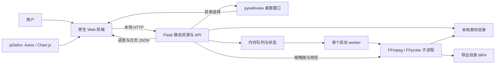

# 整体架构与启动

依据：`main.py`、`backend/app.py`、`backend/worker.py`、`frontend/`、`build.py`、`run_server.bat`；基线见 [CURRENT_STATE.md](CURRENT_STATE.md)。下述为源码事实，运行成功与否见交接验证记录。

## 技术栈及组件

| 层次 | 实际技术／依赖 | 依据与边界 |
| --- | --- | --- |
| 界面 | HTML、CSS、原生 JavaScript、HTML video | `frontend/index.html`、`script.js`、`style.css`；未发现 npm 工程或前端构建配置 |
| 浏览器库 | Axios、Chart.js | HTML 从 jsDelivr 加载，URL 未锁定版本；离线可用性未验证 |
| HTTP 服务 | Python、Flask、flask-cors | `backend/app.py`，`CORS(app)`；同服务提供静态资源及 JSON／媒体接口 |
| 桌面壳 | pywebview（导入名 `webview`） | `main.py` 创建原生窗口，并注入 `WEBVIEW_WINDOW` |
| 任务执行 | `threading`、`queue.Queue`、全局字典 | 模块导入时创建单个 daemon worker；串行导出 |
| 媒体处理 | 外部 `ffmpeg.exe`、`ffprobe.exe` | `subprocess` 调用，项目 `bin/` 或打包资源目录定位 |
| 打包 | PyInstaller | `build.py` 构建单文件窗口应用并打包前后端、bin、图标 |

未发现 `requirements.txt`、`pyproject.toml`、依赖锁文件或 CI。`tests/` 新增标准库 unittest 和 Node 内置行为测试，媒体回归依赖本地 bin 工具；不需要安装测试框架。支持的最低 Python 和依赖版本未声明；已有 `.cpython-312.pyc` 不是兼容性声明。初始化核对使用 Python 3.12.2，不代表最低要求。



## 三种入口及前提

以下命令为接手说明，本轮没有启动服务、构建或安装依赖。均从项目根目录运行，先确保所需 Python 包和本地工具已准备好。

1. **桌面方式**：`python main.py`。导入 `backend.app`（此时启动 worker），新建 daemon 线程在 `127.0.0.1:5000` 启动 Flask（`debug=False`、`threaded=True`），创建 `1650×1000` 的 pywebview 窗口并加载该地址；将窗口写入 `app.config['WEBVIEW_WINDOW']`，进入 WebView 事件循环。有图标则传入 `app_icon.ico`。WebView 对系统运行时的要求未验证。
2. **浏览器方式**：已有依赖时可运行 `python -m flask --app backend.app run --host 127.0.0.1 --port 5000`，再打开 `http://127.0.0.1:5000/`。这是根据 Flask app 对象与既有 bat 整理的显式等价启动命令，未实跑。`run_server.bat` 设置 `FLASK_APP=backend.app` 后执行 `python -m flask run`；它会先尝试 pip 安装 Flask、flask-cors，并检查 PATH 中的 FFmpeg。**bat 有安装副作用，本轮未运行。** `backend/app.py` 仍顶层导入 `webview`，bat 未安装 pywebview。纯浏览器方式无 `WEBVIEW_WINDOW`，原生选目录接口返回失败，应手填路径。
3. **EXE 构建**：准备 PyInstaller 及运行依赖后 `python build.py`，目标 `dist/SteamConverterPro.exe`。包含 `backend/`、`frontend/`、`bin/`、图标，收集 webview、flask、flask_cors；结束时 `finally` 清理 `build/` 和对应 `.spec`。构建本身有文件写入／清理副作用，需属于获准任务；本轮未运行。不存在本轮可验证的现成 `dist/` 产物。

端口占用、服务线程就绪与窗口加载时序未实际验证。不要承诺三种入口行为完全一致。

## 路径、配置和存储

- `get_res_path()` 以 `sys._MEIPASS` 或 `backend/app.py` 的父级项目目录定位前端资源。
- `get_ffmpeg_tool()` 以 `sys._MEIPASS` 或**当前工作目录**定位 `bin/<name>`；`main.py` 的图标定位和 `build.py` 也依赖工作目录。因此源码运行应从根目录启动，不能只依赖系统 PATH。
- 输入素材路径、导出路径由 `/api/set_path` 设置；新增 `/api/set_export_path` 独立更改导出目录。前端路径提交串行，入队前再次等待导出目录校验。没有配置文件、环境变量配置层或数据库。bat 的 `FLASK_APP` 仅用于选 Flask 应用。
- `CURRENT_CLIP_PATH`、`EXPORT_PATH`、`CONVERSION_STATUS`、`CONVERSION_QUEUE`、`PYTHON_LOGS` 全部为单进程内存；重启丢失，不应配置多进程并假定共享状态。
- 持久数据是原素材、`gamename.txt`、素材库根目录的 `<cid>.jpg`、导出目录的 `<cid>.mp4`。导出临时 `.v`、`.a` 位于输出旁；预览临时 MP4 位于系统临时目录；缩略临时文件为 `<cid>.jpg.tmp.mp4`。

## 素材布局和转换约束

```text
素材库/                       # 或输入目录下的 clips/
  clip_<字段>_<YYYYMMDD>_<HHMMSS>/
    gamename.txt              # 可选，UTF-8，覆盖默认 AppID 展示名
    video/
      fg_*/                   # 当前只使用 glob 找到的第一个目录
        init-stream0.m4s
        chunk-stream0-*.m4s   # 按文件名字典排序
        init-stream1.m4s      # 可选音频
        chunk-stream1-*.m4s
  <cid>.jpg                   # 扫描时可能生成
导出目录/
  <cid>.mp4
```

这里是代码期待的格式，不是全部 Steam 格式规范；目录中第二字段被代码用作 `AppID` 展示，不应误写为已验证的用户 SteamID。

导出拼接 init 与 chunks 后调用 FFmpeg `-c copy`，有 stream1 时在音频输入前使用 `-isync 0` 以视频输入起点为参考，保留两路相对偏移；输出端 `-avoid_negative_ts make_zero` 对所有轨道统一平移。合成分段已验证音频早／晚、B 帧、大时间戳、无音轨及进度；真实 Steam 素材仍待验收。本地 FFmpeg 8.0.1 支持该参数，替换旧工具时需核实。无用户可选编码和格式配置。预览单独走 stream0 前 10 段的 H.264 流式转换，不等同完整导出，也没有 Range／定位处理。缺片段、多个 `fg_*`、损坏数据和输出覆盖等风险统一见 [KNOWN_ISSUES.md](KNOWN_ISSUES.md)。

2026-10-30 导出进度按阶段发布，两轨 chunk 分别计数，拼接按总字节估算，封装按 FFprobe 时长及 FFmpeg 媒体时间估算；未知时长不定显示，成功前不达 100%。仍使用原 `/api/progress`，字段见 [API.md](API.md)。完成检查退出码及非空文件，清理警告单独展示；未增加恢复／持久化或改变输出覆盖规则。

现有 README 声称添加 FFmpeg 至 PATH，但当前代码直接调用 `bin/` 中的 exe，且 bat 的依赖安装不完整。本轮保留原文，通过本文件说明差异；未来变更需独立授权。
