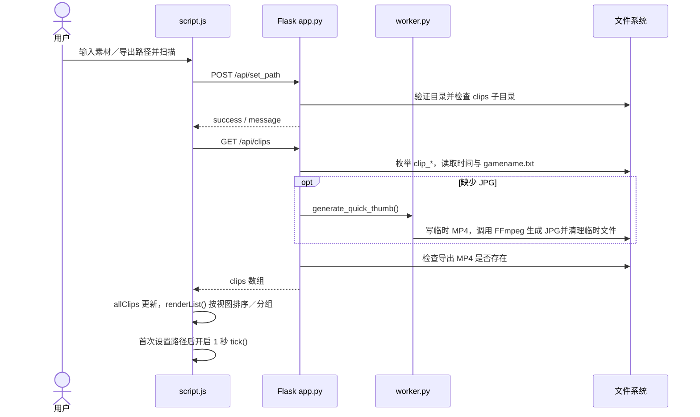
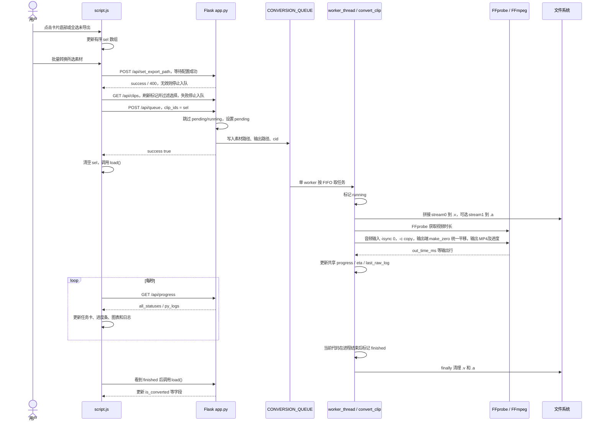

# 数据流与运行流程

依据当前实现；已运行隔离合成分段及 test client，未运行真实 Steam 素材。接口字段以 [API.md](API.md) 为准，故障与限制见 [KNOWN_ISSUES.md](KNOWN_ISSUES.md)。

## 1．配置路径、扫描并展示

`setP()` 不 await `load(true)`；扫描与轮询可能交错。列表接口在 HTTP 请求线程内同步生成缩略图，不是由转换队列生成。导出选择器成功或手填 `change` → `setExportPath()` → `POST /api/set_export_path`，独立设置后端导出目录，再 `load(true)` 刷新标记、清除已导出／消失项的选择；无需重新点击扫描。`submitPaths()` 把路径设置及其刷新／入队回调作为完整串行操作。

## 2．选择、排队、导出、显示进度

上图描述当前调用链，**不保证进程退出意味着转换成功**：当前未检查返回码。`load()` 仅在显式 verbose 或数量变化时重绘，完成后状态可能不反映到卡片；问题详情由 `KI-001`、`KI-002` 维护。

转换时使用入队时已捕获的完整路径；共享状态只按 cid 索引。中途切换素材库时，任务仍运行原路径，但新素材库可能和旧库 cid 冲突，详见 `KI-004`。

## 3．短预览和关闭播放器

用户悬停素材图片 800ms → `createClipEl()` 创建静音循环 video，或点击图片 → `openPlayer()` 打开弹层 → video 请求 `/api/stream/<cid>` → `stream_clip()` 找第一个 `video/fg_*` → 在系统临时 MP4 拼接 stream0 init 与前 10 个 chunk → 启动 FFmpeg H.264 分片 MP4 输出到 stdout → Flask `Response` 流 → video 播放。

离开悬停会清空预览容器；关闭弹层时 `closePlayer()` 暂停、移除 src 并 `load()`。服务端从创建临时文件起进入 try/finally：正常结束、断开或拼接／启动失败均进入清理。若进程仍运行，先 terminate；wait 最多 3 秒，超时后 kill 并再次 wait 最多 3 秒；关闭 stdout 后才删除本请求临时文件，防止 Windows 输入文件锁尚未释放。清理失败记 warning，不遮蔽原错误；外部占用或应用被强杀仍可能残留，见 `KI-008`。预览未读取 stream1，也不是对已导出的 MP4 做播放。

## 数据生命周期

| 数据 | 保存位置 | 生命周期／重启行为 |
| --- | --- | --- |
| `sel`、`allClips`、视图、前端日志索引 | 浏览器内存 | 页面刷新重建 |
| 路径、队列、任务状态、最近 100 条后端日志 | Python 进程内存 | 进程停止即丢失 |
| 素材分段、游戏名文本 | 本地素材目录 | 本轮不修改；运行扫描会在素材库根额外写缩略文件 |
| 缩略 JPG、导出 MP4 | 素材库／导出目录 | 跨进程保留；输出仅按存在与否识别 |
| 临时媒体文件 | 输出旁／素材库旁／系统临时目录 | 正常路径尝试清理，异常或进程退出可能残留 |

不存在已发现的云同步、后台恢复或持久任务数据库。记忆 Markdown 保存的是项目知识与进度，不会使应用自身的运行队列持久化。
